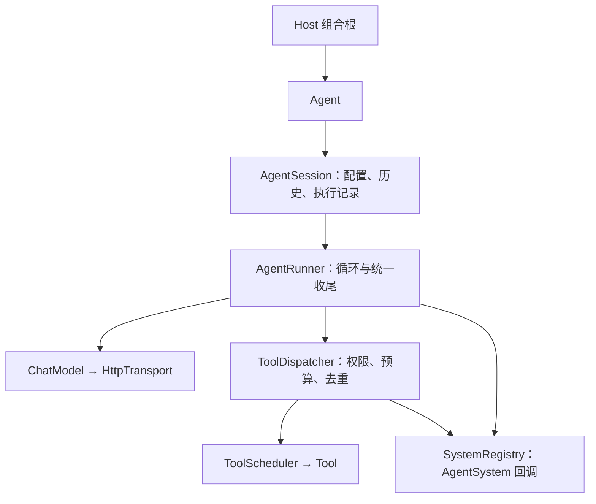

# Agent 循环与运行时架构

- 状态：当前运行时契约已实现，后半部分保留 A2 原始设计草案
- 目标版本：A2
- 关联：`ChatModel`、CLI host、DeepSeek Chat Completions
- 完整对象模型与生命周期见 [运行时架构](runtime-architecture.md)

## 当前运行时契约（已实现）

以下是当前代码的装配与并发契约；后面的 A2 草案保留用于解释设计演进，旧接口示例不再作为接入依据。



> 事件队列（`RunEvent` / `EventDispatcher` / UI 线程投递）本阶段不实现，留到 Router/Worker 或第二个宿主出现后再设计。

### 配置与依赖所有权

- `AgentDescriptor` 只保存身份/名称/版本/能力；初始 profile 作为 `Agent` 构造参数传入，唯一可变运行配置由 `AgentSession` 持有。`Agent::Profile()`、`History()` 和 `Session::Records()` 返回快照，外部不能通过引用修改内部状态。
- `SetProfile` 同步更新历史中的 System 消息；`Reconfigure(profile, executor)` 在空闲时一起切换配置和执行器。`Agent::Dependencies()` 返回当前执行器快照，不保留过期执行器。
- `RunnerDependencies` 必须显式传入 model、tools、tool policy、context policy、output policy、scheduler、systems，缺失时构造失败。默认策略只在 host 组合根选择，Runner 不再读取 `ServiceRegistry`。
- Session 拥有 executor，Runner 拥有依赖，`OpenAiChatModel` 拥有 transport，全部使用 `shared_ptr`。`ServiceRegistry` 也持有父 registry 的共享所有权；该可选宿主注册表须在发布到工作线程前完成配置，不支持并发修改。
- Runner 构造时复制工具注册表，注册能力不会随 host 后续编辑改变。切换工作区通过新建执行器并 `Reconfigure` 完成。共享的 model、transport、tool 和自定义 policy 实例本身必须支持并发，或由 host 为每个会话创建独立实例。

### RunContext 与 CallContext

每个已接受的 Send 创建一个 runtime `RunContext`，携带 `session_id`、唯一 `run_id`、`core::CallContext`（取消 + deadline）及预算，贯穿 model、tool、scheduler、observer。一次 Turn 内多次模型请求共享截止时间，不重新计时。

| 字段 | 默认值 | 语义 |
|---|---|---|
| `max_steps` | 8 | 本轮最多模型调用次数 |
| `turn_timeout_ms` | 120000 | 本轮总耗时预算，包含所有模型和工具调用 |
| `max_tool_calls` | 64 | 本轮工具调用尝试次数，包含拒绝和缓存重放；0 禁止执行 |
| `max_tool_output_bytes` | 32768 | 工具正文累计字节预算，含重放；固定截断提示不计入正文预算 |
| `timeout_ms`（model 配置） | 30000 | 单次 HTTP 时限，实际取它与本轮剩余时间的较小值 |

`Send(input, RunOptions)` 可指定取消信号和本次超时；`Send(input, stop_token)` 仍可使用。工具/自定义 scheduler 必须协作检查 context：框架会在调用边界检查，但不能强制中断不配合的同步代码。

结果使用 `RunStatus::{Completed, Cancelled, Failed, BudgetExceeded, Busy}` 与 `RunErrorCode`；`ChatResponse` / `ToolResult` 只携带 `core::CallError`。调用者检查 `result.Ok()` / `status` / `error_code`，不需要匹配错误文本。`AgentRunResult` 携带 `session_id` / `run_id`。

### 工具执行与统一收尾

`ToolDispatcher` 负责允许列表、策略检查、scheduler 调度、输出限制和操作记录。一次 Turn 中同一 tool call ID 与相同名称/原始参数字符串只执行一次，后续复用结果并继续消耗调用和输出预算；同一 ID 携带不同参数视为协议错误。缓存仅在本轮生效，不承诺跨轮、跨进程或不同 ID 的 exactly-once。

`ToolExecutionRecord` 在进入 scheduler 前创建，`execution_started` 表示已提交调度、可能产生副作用；它不承诺操作完成。记录包含工具结果和错误，保存在返回值与 `Session::Records()` 中，独立于对话历史。重放不增加实际执行记录，`tool_attempts` 仍增加。

| 结束原因 | 对话历史 | 工具记录 |
|---|---|---|
| 成功 | 提交完整本轮 | 保留 |
| 取消、总截止时间、运行时内部异常 | 恢复本轮开始前的历史 | 保留已经登记的操作 |
| 模型失败、响应不完整、步骤/工具/输出预算耗尽 | 保留用户输入和完整工具批次，移除未完成的 assistant/tool 批次 | 保留 |
| 输入或配置检查失败 | 不开始本轮、不修改历史 | 无工具执行 |
| 同会话 Busy | 不开始本轮、不修改历史 | 不新增记录 |

`AgentSession` 的 `TurnTransaction` 生成最终结果并处理历史；`AgentExecutor` 只写 `TurnWorkspace` 并返回 `RunOutcome`。`ExecuteTurn` 统一事务、TurnStarted/TurnFinished 与 executor 调用顺序；观察者异常被通知层隔离，不改变执行结果。事件总线/异步 UI 队列留到宿主层设计。

取消/回滚历史不会撤销已经发生的工具副作用，也不会自动重试。本轮操作记录目前仅在内存中保存，`ClearHistory` 不清除记录；持久化 SessionStore、跨进程幂等恢复与 Memory 属于后续范围。

### 并发、观察者和宿主线程

- 同一 Session 同时只接受一个 Send；并发调用和同步回调重入均立即返回 `Busy`，`ClearHistory` / `SetProfile` / `Reconfigure` 返回 false。运行使用配置和历史快照，读状态不会等待网络调用。
- 不同 Session 可并行。每个 Session 必须使用独立 Runner / `SystemRegistry` / metrics / tracer；底层无状态、线程安全依赖可以共享。
- CLI 在会话作用域创建 metrics、tracer 和 UI 上下文；host 注册表只提供可共享命令等服务。`MetricsCollector::Snapshot()` 加锁返回副本。
- `AgentSystem` 阶段回调仍在执行线程同步通知；`AgentRunner` 隔离观察者异常。宿主 UI 线程事件队列本阶段不实现。
- `ToolScheduler` 是需要主线程工具的调度接入点，默认实现直接执行；宿主实现须在等待期间处理取消/截止时间并避免主线程等待自身。框架未引入后台线程池，`Send` 仍是同步 API。
- 直接调用低层 `AgentExecutor::RunTurn(profile, workspace, input, context)` 的宿主须自行保证 `TurnWorkspace` 串行访问；推荐通过 Session 使用以上约束。

### 接口迁移

`Agent` 构造参数改为 descriptor + initial profile + dependencies；descriptor 不再持有 profile。`AgentRunner(model, services)` 改为 `AgentRunner(RunnerDependencies)`；Session/Model 构造接收拥有所有权的 `shared_ptr`。`ChatRequest::stop_token` 迁移到 `call.stop_token`，自定义 `Tool::Execute` 接收 `const CallContext&`，`AgentExecutor::RunTurn` 接收 runtime `RunContext`；运行结果的 `.ok` 改为 `.Ok()`。`AgentSystem` 阶段回调保持不变，观察者异常被隔离。

## 1. 背景

A1 已经完成：

- CLI 单轮问答；
- 交互式终端聊天（唯一 CLI 入口）；
- 配置分层（`resources/config.json` + `config.local.json`）；
- OpenAI 兼容的 `OpenAiChatModel` + 临时 `WinHttpTransport`。

A1 的每一次用户输入只对应一次 `ChatModel::Chat()`。A2 要让模型可以：

1. 请求调用工具；
2. 读取工具结果；
3. 继续决策，直到给出最终回答。

这就是 Agent 循环。A2 只做**单 Agent、同步、单会话**的最小闭环，为未来的异步、多会话、Router/Worker 留出接口。

## 2. 目标与非目标

### 目标

- 一个可测试的默认 ReAct 执行器（`AgentRunner`），支持 `max_steps` 限制；
- 通过 `AgentExecutor` 接口隔离执行策略，避免 host/core 绑死在单一流程上；
- 工具通过统一接口注册和调用；
- 模型请求/响应支持 `tool_calls` 和 `tool` 消息；
- 第一个工具：`read_file`（只读、限制在工作区）；
- 离线测试不依赖网络和真实模型；
- 每轮决策和工具调用可观测（Tracer 接口，先做空实现或简单日志）。

### 非目标（A2 不做）

- Router / Worker 双层架构；
- 异步 ReAct / 事件队列；
- 多 Agent 协作、跨会话上下文；
- Watchdog、投机执行；
- 会话持久化；
- 写文件、执行命令等危险工具；
- UE 宿主接入。

这些留给 A3/A4，A2 只保证接口不挡路。

## 3. 分层与职责

```text
hosts/cli/ue/im
        │  产生用户事件 / 展示输出
        ▼
agent（编排层）
  AgentExecutor 接口 / AgentRunner（ReAct 默认实现）
  ToolRegistry / AgentProfile / ContextProvider / Tracer 实现
        │
        ▼
core（接口与数据）
  ChatModel / ChatMessage / Tool / ToolResult / ToolSpec / Tracer 接口
        │
        ├── integrations/model（OpenAI 序列化、tool_calls 解析）
        ├── tools（read_file 等具体工具）
        └── integrations/transport（HTTP）
```

原则：

- `core` 不依赖 nlohmann/json、不带平台/网络头文件；
- 工具参数和工具结果在 core 里用 **JSON 字符串**传递，具体工具自己解析；
- host 只负责输入/输出，不实现循环；
- `AgentRunner` 不读 stdin、不读全局配置，依赖通过构造参数注入。

> 实现位置可以在 A2 评审后微调：如果 `source/core` 过重，就新增 `source/agent` 库；接口归属不变。

## 4. 数据模型

### 4.1 消息

```cpp
enum class ChatRole
{
    System,
    User,
    Assistant,
    Tool,
};

struct ToolCall
{
    std::string id;
    std::string name;
    std::string arguments_json;
};

struct ChatMessage
{
    ChatRole role = ChatRole::User;
    std::string content;
    // assistant 消息可能同时带 content 和 tool_calls
    std::vector<ToolCall> tool_calls;
    // role == Tool 时必填
    std::string tool_call_id;
};
```

### 4.2 请求与响应

```cpp
struct ToolSpec
{
    std::string name;
    std::string description;
    std::string parameters_json;  // JSON Schema 字符串
};

struct ChatRequest
{
    std::string model;
    std::vector<ChatMessage> messages;
    std::vector<ToolSpec> tools;
    double temperature = 0.0;
    int max_tokens = 1024;
};

struct ChatResponse
{
    bool ok = false;
    std::string content;
    std::vector<ToolCall> tool_calls;
    std::string error;
};
```

说明：

- `tools` 为空时就是普通聊天，A1 行为不变；
- `tool_calls` 为空表示模型给了最终回答；
- `content` 与 `tool_calls` 同时存在是合法的，最终回答优先取 `content`。

### 4.3 工具

```cpp
struct ToolResult
{
    bool ok = true;
    std::string content;
    std::string error;
};

class Tool
{
  public:
    virtual ~Tool() = default;

    virtual std::string Name() const = 0;
    virtual std::string Description() const = 0;
    virtual std::string ParametersJson() const = 0;
    virtual ToolResult Execute(const std::string& arguments_json) = 0;
};
```

- 工具名全局唯一，建议 snake_case（`read_file`）；
- `ParametersJson` 返回 JSON Schema，用于生成 OpenAI `tools` 数组；
- 工具自己解析 `arguments_json`，失败时返回 `ok=false` + 可读错误；
- 所有工具执行必须设置上限：文件大小、输出长度、超时。

### 4.4 注册表

```cpp
class ToolRegistry
{
  public:
    void Register(std::shared_ptr<Tool> tool);
    Tool* Find(const std::string& name) const;
    std::vector<ToolSpec> Specs() const;
};
```

- 注册重复名称直接报错/拒绝；
- `Specs()` 只返回允许本轮使用的工具；
- 查找失败时由 `AgentRunner` 转成工具错误结果回给模型，而不是直接崩溃。

### 4.5 Profile 与会话

```cpp
struct AgentProfile
{
    std::string system_prompt;
    std::vector<std::string> tool_names;
    int max_steps = 8;
};

struct Conversation
{
    std::vector<ChatMessage> messages;
};
```

- `Conversation` 是可序列化的会话状态，未来可被 Router 分配/持久化；
- `AgentProfile` 是场景配置：代码助手、问答、自动化流程只是工具集和提示词不同；
- 单 Agent 就是“一个 Conversation + 一个 AgentRunner”。

### 4.6 AgentSystem / Tracer

`AgentSystem` 是 loop 参与者基类，默认空实现；`Tracer` 是只读观察者的一种：

```cpp
class AgentSystem
{
  public:
    virtual ~AgentSystem() = default;

    virtual void OnTurnStart() {}
    virtual void OnModelRequest(const ChatRequest& request) {}
    virtual void OnModelResponse(const ChatResponse& response) {}
    virtual void OnToolCall(const ToolCall& call) {}
    virtual void OnToolResult(const ToolCall& call, const ToolResult& result) {}
};

class Tracer : public AgentSystem
{
};
```

A2 已提供 `NullTracer` 和文件 trace（JSONL，默认写入 `traces/`），并支持 usage 聚合。

多个 system 用 `SystemRegistry` 注册：

```cpp
auto systems = std::make_shared<SystemRegistry>();
systems->Add(metrics);
systems->Add(file_trace);
services.Set<SystemRegistry>(systems);
```

- `Tracer` 是只读观察者，不能修改请求/响应；
- 需要审批、脱敏、限流时用独立 `ModelInterceptor` / `ToolInterceptor`；
- 不要让插件继承 `AgentSession` 来 override；
- Runner 只遍历 `AgentSystem`，不直接依赖具体 Tracer。

## 5. AgentRunner（默认 ReAct 执行器）

```cpp
class AgentExecutor
{
  public:
    virtual ~AgentExecutor() = default;

    virtual RunOutcome RunTurn(const AgentProfile& profile, TurnWorkspace& workspace,
                               const std::string& user_input, const RunContext& context) = 0;
    virtual std::shared_ptr<core::SystemRegistry> SystemRegistry() const { return nullptr; }
};

class AgentRunner : public AgentExecutor
{
  public:
    explicit AgentRunner(RunnerDependencies dependencies);

    RunOutcome RunTurn(const AgentProfile& profile, TurnWorkspace& workspace,
                       const std::string& user_input, const RunContext& context) override;
    std::shared_ptr<core::SystemRegistry> SystemRegistry() const override;
};
```

### 5.1 单轮流程

```text
1. Session 预检（空输入/预算/已取消），失败不开始本轮
2. Session snapshot profile/history，TurnTransaction.Start
3. Session 发出 TurnStarted(TurnEvent)
4. Runner 校验依赖/tool_names，进入模型 ↔ 工具循环
5. 模型/工具事件由 Runner 发出；消息写入 TurnWorkspace
6. Runner 返回 RunOutcome
7. Session 根据 RunOutcome commit/rollback
8. Session 发出 TurnFinished(TurnEvent)
```

Runner 内循环：

1. 检查 `RunContext::Interruption` 和 budget；
2. 构造 `ChatRequest`，`messages` 由 `ContextPolicy` 从 workspace conversation 生成；
3. `ChatModel::Chat`，异常转 `CallError::ModelFailure`；
4. 检查 finish_reason / 空响应；
5. 无 tool_calls 且 content 非空 → 追加 assistant，返回 Completed；
6. 否则追加 assistant(tool_calls)，逐个交给 `ToolDispatcher`；
7. 工具结果回填 `role=Tool`，继续下一次模型调用；
8. 达到 max_steps → `RunErrorCode::ModelCallLimit`。

### 5.2 终止条件

- 模型返回无 `tool_calls` 且 content 非空 → 成功；
- 达到 `max_steps` → 失败，错误信息明确，保留已完成消息；
- 模型调用失败 → 失败，保留已追加消息；
- `finish_reason` 为 length / content_filter / insufficient_system_resource → 失败；
- 空 content 且无 tool_calls → 失败，不写 assistant；
- 工具失败不终止循环：把错误作为工具结果回给模型，让它选择重试或换方案；
- 模型/工具抛异常 → 转成错误结果，不终止进程。

### 5.3 安全限制

- 第一版工具只读；
- `read_file` 只允许 workspace 相对路径，拒绝绝对路径和 `..` 越界；
- 拒绝 symlink/junction 逃逸和敏感文件（`.env`、`config.local.json`、`.git`、私钥等）；
- Windows 打开后基于句柄最终路径二次复核，降低 TOCTOU 风险；
- 单文件读取上限（例如 256KB），工具输出有每轮总预算；
- 工具执行不能阻塞过久；
- 写操作、命令执行必须等到审批机制和沙箱设计完成后再加。

### 5.4 执行策略可插拔

`AgentRunner` 是默认的 **ReAct 执行器**，不是所有应用的固定流程。SDK 只暴露 `AgentExecutor` 接口，host 组合根构造具体执行器：

```cpp
class AgentExecutor
{
  public:
    virtual ~AgentExecutor() = default;

    virtual RunOutcome RunTurn(const AgentProfile& profile, TurnWorkspace& workspace,
                               const std::string& user_input, const RunContext& context) = 0;
    virtual std::shared_ptr<core::SystemRegistry> SystemRegistry() const { return nullptr; }
};
```

候选执行器：

| 执行器 | 适用场景 | A2 |
|---|---|---|
| ReActExecutor（AgentRunner） | 通用工具调用、代码助手 | 默认实现 |
| PlanExecuteExecutor | 先规划再执行的复杂任务 | 后续 |
| StateMachineExecutor | NPC 对话/行为、游戏状态机 | 后续 |
| WorkflowExecutor | DAG / 低代码流程 | 后续 |

host 只依赖 `AgentExecutor`，组合根（CLI 的 `main.cpp`）负责构造 `AgentRunner` 并注入。这样以后新增执行器不需要改 CLI/UE host。

### 5.5 应用流程与上下文结构不同

不同应用的流程和上下文本来就不一样，不能用同一个 Profile 硬套：

| 应用 | 上下文结构 | 典型流程 |
|---|---|---|
| 游戏引擎助手 | 项目文件、API 文档、编辑器选中内容、构建错误 | ReAct + 工具 + 人工确认 |
| NPC Agent | 世界状态、角色设定、玩家关系、记忆 | 状态机/行为树；模型只在决策点调用 |
| 自动化流程 | 任务状态、审批记录、外部系统数据 | DAG / 审批流；模型是其中节点 |
| 知识问答 | 检索结果、引用、权限 | 检索 → 重排 → 生成，可能没有工具循环 |

建议引入：

```cpp
class ContextProvider
{
  public:
    virtual ~ContextProvider() = default;

    virtual std::string BuildContext(const AgentContextRequest& request) = 0;
};
```

- 每个应用注册自己的 ContextProvider；
- `AgentProfile` 选择工具集、ContextProvider、执行器和提示词；
- 上下文先用 JSON 字符串承载，避免 core 绑定具体领域结构。

### 5.6 未来：低代码 Flow 层

低代码拼装的目标是“节点图 + 执行器注册”，而不是把流程写死在 C++ 里：

```json
{
  "version": 1,
  "nodes": [
    {"id": "input", "type": "input"},
    {"id": "ctx", "type": "context", "provider": "ue_editor"},
    {"id": "llm", "type": "model", "model": "deepseek-flash"},
    {"id": "check", "type": "condition", "expr": "need_file"},
    {"id": "read", "type": "tool", "name": "read_file"},
    {"id": "out", "type": "output"}
  ],
  "edges": []
}
```

候选节点类型：

- `input` / `output`
- `model`
- `tool`
- `condition`
- `context`
- `sub-agent`
- `human-approval`

低代码层要成立，需要先有稳定契约：

- 节点输入/输出端口类型；
- 上下文 schema；
- 工具/执行器注册表；
- 错误、超时、取消传播；
- trace 与调试能力。

**A2 不实现 Flow 层**，只保证原语（消息、工具、执行器、上下文、trace）不挡路。

### 5.7 与 DeepSeek 插件思想的关系

方向一致，但层次不同：

- **DeepSeek function calling / tools**：能力插件化的协议；
- **DeepSeek Harness skills / plugins / 事件源**：host 侧扩展；
- **Super-agent 的 Router / Worker / 事件订阅**：编排与执行分离。

我们的映射：

| 概念 | 对应 |
|---|---|
| 能力插件 | `Tool` / 未来 `ContextProvider` / 事件源 |
| 执行策略插件 | `AgentExecutor`（`AgentRunner` 是默认实现） |
| 编排层 | 未来 Flow 图 / Router |
| 宿主插件 | CLI / UE / IM host |

所以插件化解决“能力怎么接”，执行器/Flow 解决“流程怎么编排”，两者互补。

### 5.8 MCP：远程工具插件协议

MCP（Model Context Protocol）**本身不是单个 Tool**，而是“能力发现 + 调用”的协议。一个 MCP server 可以暴露：

- tools
- resources
- prompts

映射到我们的分层：

| MCP 概念 | 我们的对应 |
|---|---|
| MCP server | 远程插件/能力提供方 |
| MCP tool | 一个 `McpTool`，实现 `Tool` 接口 |
| MCP resource | `ContextProvider` |
| MCP prompt | `AgentProfile` / Prompt 模板 |
| MCP client / transport | `source/plugins/mcp`，负责连接/认证/JSON-RPC |

所以 agent 看到的是 `read_file`、`search_web` 这些独立工具，而不是一个叫 `mcp` 的大工具。

```text
MCP server
  ├── tool: read_file   → McpTool("read_file")
  ├── tool: search_web  → McpTool("search_web")
  └── resource: docs    → McpContextProvider
```

约束：

- `McpTool` 实现 `Tool` 契约，`Execute()` 内部调用 MCP `tools/call`；
- `ToolSpec.parameters_json` 来自 MCP tool 的 `inputSchema`；
- `McpClient`、连接管理、认证不进入 core；
- MCP 工具是远程不可信能力，需要 allowlist、超时、结果截断和 prompt injection 防护；
- **A2 不实现 MCP**；当前 `Tool` 接口已经足够以后接 `McpTool`。

## 6. OpenAI / DeepSeek 协议

请求体在 A1 基础上增加：

```json
{
  "tools": [
    {
      "type": "function",
      "function": {
        "name": "read_file",
        "description": "Read a text file inside the workspace",
        "parameters": {
          "type": "object",
          "properties": {
            "path": {"type": "string"}
          },
          "required": ["path"]
        }
      }
    }
  ],
  "tool_choice": "auto"
}
```

响应解析：

- `choices[0].message.tool_calls[]` → `ToolCall { id, function.name, function.arguments }`；
- `arguments` 是 **JSON 字符串**，不要二次解析成对象再存 core；
- `tool_calls` 是否为空决定循环是否继续；
- `finish_reason` 由 adapter 读取；`length` / `content_filter` / `insufficient_system_resource` 视为失败。

工具结果回传：

```json
{
  "role": "tool",
  "tool_call_id": "call_xxx",
  "content": "文件内容或错误信息"
}
```

A2 开工前先做一次真实 API 验证（见 §10.2）。

## 7. 错误处理

| 情况 | 行为 |
|---|---|
| 模型 HTTP/JSON 错误 | 返回失败，不追加 assistant 消息 |
| 模型没有返回 content 也没有 tool_calls | 视为失败，错误信息明确 |
| 未知工具名 | 生成错误 ToolResult，回给模型 |
| 工具参数 JSON 非法 | 工具返回 `ok=false`，回给模型 |
| 工具执行失败 | 回给模型；连续失败超过阈值则终止 |
| max_steps 达到 | 返回失败，附带已完成的消息 |
| 会话历史过长 | `AgentProfile.max_context_chars` 控制发送给模型的字符预算，按 User 边界裁剪旧轮次 |

## 8. 可观测性

A2 已实现 Tracer 接口 + NullTracer + JSONL `FileTracer`：

```text
traces/
  <session-id>.jsonl
```

多个 system（metrics、文件 trace、UI）通过 `SystemRegistry` 注册，Runner 在每个阶段遍历：

```cpp
auto systems = std::make_shared<SystemRegistry>();
systems->Add(metrics);
systems->Add(file_trace);
services.Set<SystemRegistry>(systems);
```

事件字段：

- `event`: `turn_start` / `model_request` / `model_response` / `tool_call` / `tool_result` / `turn_end`
- `turn` / `step`
- `duration_ms`
- `tool_name` / `tool_call_id`
- `finish_reason` / `usage`
- `ok` / `error`

内容会截断到 2000 字符，并把 `sk-...` 替换为 `[REDACTED]`；不能记录 Authorization header 或完整密钥。

## 9. 测试策略

`FakeChatModel`：按预设脚本依次返回响应，同时记录收到的 `ChatRequest`。

`FakeTool`：记录调用参数，返回固定结果或错误。

测试用例：

1. 无工具调用 → 一次回答，`steps=1`；
2. 一次 `tool_calls` → 执行工具 → 第二次模型返回最终答案；
3. 多工具调用 → 按顺序执行，所有结果都回传；
4. 未知工具 → 错误结果回传，模型可恢复；
5. 工具失败 → 错误回传，模型可恢复；
6. 达到 `max_steps` → 返回失败；
7. `read_file` 路径越界 → 拒绝；
8. 请求中的 `tools` 只包含 profile 允许的工具。

真实 API 测试单独做，不进入 ctest。

## 10. 里程碑

### A2.0 协议验证

- 用 curl 发一个带 `tools` 的请求；
- 确认返回 `tool_calls` 结构；
- 回传 `role=tool` 后模型能继续回答。

### A2.1 最小闭环

- core 数据模型扩展；
- `AgentExecutor` 接口 + `Tool` / `ToolRegistry` / `AgentRunner`（ReAct 默认实现）/ `AgentProfile` / `Tracer`；
- `read_file` 工具；
- FakeChatModel 离线测试；
- CLI 默认走 `AgentRunner`；`/tools` / `/workspace` / `tool_names` 在交互命令/配置中设置。

### A2.2 真机与可观测

- 真实 DeepSeek tool call 联调；
- JSONL `FileTracer`（已实现）；
- `max_context_chars` conversation 预算（已实现）；
- 错误/重试/限制完善。

### A2.3 演进预留

- trace usage 聚合与 viewer（已实现 `/stats today|all` / `/trace`）；
- 异步 Step 驱动接口（不实现）；
- Router/Worker 需要的 session_id / 事件订阅字段。

## 11. 未来演进映射

| 未来能力 | A2 预留点 |
|---|---|
| 执行策略插件 | `AgentExecutor` 接口；`AgentRunner` 是默认 ReAct 实现 |
| 低代码 Flow | 原语稳定后，以节点/端口/上下文 schema 为基础单独做 |
| 应用上下文 | `ContextProvider` 接口；Profile 选择 provider |
| MCP 远程工具 | 每个 MCP tool 对应一个 `McpTool`；McpClient/连接管理放 `source/plugins/mcp` |
| 插件系统 | `PluginManifest` + `PluginKind` + 动态 loader；`source/plugins` |
| 服务/插件实例 | `ServiceRegistry` + 稳定 service id；agent/runtime 层 |
| Agent 组合根 | `AgentRuntime` + `AgentDependencies`，宿主负责组装 |
| 异步 ReAct | `AgentRunner::Step()` 与循环驱动分离，未来用事件队列调用 Step |
| Router / Worker | `Conversation` + `AgentExecutor` 可实例化多个，Router 负责分配 |
| 多会话 | Conversation 可序列化、带 session_id |
| Watchdog | Tracer 事件 + Policy 钩子 |
| UE 宿主 | 只换 host，`AgentExecutor` 不变 |
| 会话持久化 | Conversation 通过 `MessageStore` 接口落盘 |

## 12. 插件化与服务模型

### 12.1 原则：能力插件化，内核稳定

借鉴 DeepSeek Harness 的插件思想，但不做成“字面上的万物皆插件”：

```text
Kernel（agent/runtime 层，稳定）
├── 插件加载器 / 生命周期
├── ServiceRegistry / ToolRegistry
├── manifest / 版本 / 依赖解析
├── 权限 / 沙箱 / 审批
├── 消息协议 / 事件总线
└── AgentRuntime / Policy / Tracer

Core（稳定契约）
├── ChatModel
├── Tool / ToolSpec / ToolResult
├── ContextProvider
├── AgentExecutor
├── Conversation
└── Message / Usage

Plugins（可替换能力）
├── Tool plugins
├── ContextProvider plugins
├── Executor plugins
├── Model plugins
├── Tracer plugins
└── EventSource plugins（以后）
```

判断标准：

- **能力**可以插件化；
- **加载、注册、权限、协议、生命周期**必须留在内核；
- 否则会出现插件 API 不稳定、依赖地狱、权限漏洞和调试困难。

### 12.2 插件与服务不是一回事

| 概念 | 含义 |
|---|---|
| 插件 | 可加载、可发布的代码/资源包 |
| 服务/插件实例 | 插件注册到运行时里的实例 |
| 能力 | 组件暴露给 Agent/工具使用的接口 |

一个插件可以注册多个组件；一个组件可以来自内置代码，也可以来自动态插件。

### 12.3 PluginManifest

```cpp
enum class PluginKind
{
    Tool,
    ContextProvider,
    Executor,
    Model,
    Tracer,
    EventSource,
};

struct PluginManifest
{
    std::string name;
    std::string version;
    PluginKind kind;
    std::string entry;
    std::vector<std::string> dependencies;
    std::vector<std::string> permissions;
};
```

约束：

- 插件名唯一；
- 版本遵循 semver；
- `dependencies` 只声明加载顺序/服务依赖，不自动解决复杂依赖图；
- 权限先做声明和校验，具体沙箱能力后续加；
- 动态插件用稳定服务 ID / C ABI，不跨 DLL 传 C++ 对象。

### 12.4 ServiceRegistry

放在 agent/runtime 层，不放进 core。registry 是组合作用域，不是全局单例：

```cpp
class ServiceRegistry
{
  public:
    explicit ServiceRegistry(const ServiceRegistry* parent = nullptr);

    template <typename T>
    void Set(std::shared_ptr<T> service);

    template <typename T>
    std::shared_ptr<T> Get() const; // local -> parent

    template <typename T>
    std::shared_ptr<T> CreateOrGet(const std::function<std::shared_ptr<T>()>& factory);

    const ServiceRegistry* Parent() const;
};
```

用途：

- Host scope：transport、model、metrics、trace、CommandRegistry、HostContext；
- Agent scope：tools、policies、context providers、executor；
- `Get` 先查 Agent 本地，再 fallback 到 Host；
- `Set` 只写当前 scope；
- parent 生命周期必须长于 child；
- `CreateOrGet` 用于可选服务的懒创建；
- 动态插件以后增加 service_id 重载，避免跨 DLL RTTI/ABI 问题；
- 必需服务（model、tools、executor）仍优先显式注入。

### 12.5 依赖注入优先，服务查询补充

| 依赖类型 | 推荐方式 |
|---|---|
| 必需依赖（model、tools、executor） | 构造函数/AgentDependencies 注入 |
| 可选环境服务（world、logger、event） | `ServiceRegistry::Get` |
| 插件之间强依赖 | manifest + 加载顺序，或显式注入 |

不要在工具/插件内部到处 `GetComponent`，否则依赖关系会变成隐式的，测试和初始化顺序都会变难。

### 12.6 Agent 与 AgentDependencies

当前实现：

```cpp
using AgentScope = ServiceRegistry;

struct AgentDependencies
{
    std::shared_ptr<AgentScope> services;
    std::shared_ptr<AgentExecutor> executor;
};

struct AgentDescriptor
{
    AgentId id;
    std::string name;
    std::string version;
    std::vector<std::string> capabilities;
};

class Agent
{
  public:
    Agent(AgentDescriptor descriptor, AgentProfile initial_profile,
          AgentDependencies dependencies, std::string session_id = {});

    AgentRunResult Send(const std::string& input, const RunOptions& options = {});
    AgentRunResult Send(const std::string& input, std::stop_token stop_token);
    bool ClearHistory();

    const AgentSession& Session() const;
    const std::string& SessionId() const;
    core::Conversation History() const;

    const AgentDescriptor& Descriptor() const;
    const AgentId& Id() const;
    AgentProfile Profile() const;
    AgentDependencies Dependencies() const;

    bool SetProfile(AgentProfile profile);
    bool Reconfigure(AgentProfile profile, std::shared_ptr<AgentExecutor> executor);

  private:
    const AgentDescriptor m_descriptor;
    std::shared_ptr<AgentScope> m_scope;
    AgentSession m_session;
};
```

- Host 创建 HostScope；
- 每个 Agent 持有自己的 child `ServiceRegistry`（AgentScope）；
- AgentScope 与 Executor 必须使用同一个 `SystemRegistry`；Agent 构造时校验/采纳；
- `AgentDescriptor` 保存身份/版本/能力快照；
- `AgentSession` 持有 profile、history、executor、records、TurnTransaction、SystemRegistry；
- `AgentRunner` 只负责一次 Turn 的执行策略；`TurnTransaction` 归 Session；
- 一 NPC 一 Agent 是宿主组装方式；
- 多 Agent 编排（Router/Orchestrator）不放进 Agent；
- `AgentRuntime` 仍是未来多 Agent 的收口方案，不在当前实现。

### 12.7 双层循环

外层循环（交互方式）与内层执行策略已经分层：

```text
外层：host 循环（RunCliLoop）
  启动参数只保留 --help/--version/--config
    ↓
中层：Agent::Send(turn)
  Agent 持有身份/配置 + Conversation + Executor
    ↓
内层：AgentExecutor::RunTurn
  决定“一次 Turn 里，模型↔工具循环怎么跑”
```

当前实现：

- Host 通过 HostServices / AgentFactory 组装 `AgentDescriptor` + `Agent`，`RunCliLoop` 调用 `Agent::Send`；
- `AgentSession` 构造时注入 `AgentExecutor&`，不依赖具体 `AgentRunner`；
- `AgentExecutor` 是接口，`AgentRunner` 是默认 ReAct 实现；
- 没有 `SessionDriver` 抽象：它没有实现/调用/测试，已移除，等第二个宿主或 CLI 命令抽象落地后再设计。

组件化约束：

- `Agent` 持有 `AgentDescriptor` + `AgentSession`；`AgentSession` 持有 profile、executor、conversation、records、TurnTransaction 和 Session 级 `SystemRegistry`；
- model/tools 由组合根构造 Executor 时注入；Session 只持有 systems/executor，不查全局 registry；
- 可选服务通过 `ServiceRegistry` 在组合根解析，再注入 Executor；
- turn 级事件由 Session 发出（start 在 executor 前，end 在 commit/rollback 后），step/tool 事件由 Executor 发出；
- 新增执行器只需实现 `AgentExecutor`，不改 CLI/UE host。

### 12.8 实施顺序

1. Tool 插件：`Tool` + `ToolRegistry` + 第一个 `read_file`；
2. ServiceRegistry：给工具/插件提供可选服务查询；
3. 动态 Tool 插件：manifest + 加载器 + C ABI；
4. ContextProvider 插件；
5. Executor 插件；
6. Skill / Command / EventSource 插件。

每一步只开放一种插件能力，内核 API 稳定后再扩下一种。

## 13. 已达成共识与待确认决策

### 已达成共识

- 单一 ReAct loop 只是默认执行策略，不是所有应用的业务流程；
- `AgentRunner` 定位为默认 ReAct 执行器，未来通过 `AgentExecutor` 接口替换；
- 不同应用（引擎助手/NPC/自动化/知识问答）使用不同上下文结构和 Flow；
- 低代码 Flow 是上层产品形态，依赖稳定原语后再做；
- Tool 属于插件能力层，`Tool` 接口在 core，`ToolRegistry` 在 agent 层；
- MCP 是远程工具插件协议，不是单个 Tool；每个 MCP tool 以后映射为一个 `McpTool`；
- 通用层不绑定 NPC/UE；Agent 是组件容器，由宿主组装；
- 能力插件化，加载/注册/权限/生命周期留在内核；
- 必需依赖优先构造注入，ServiceRegistry 只用于可选服务；
- 方向与 DeepSeek 的插件化 + 编排/执行分离一致。

### 待确认决策（部分已解决）

1. `AgentExecutor` 接口在 A2 就引入，还是先写 `AgentRunner` 后续再抽；（已解决：接口已引入）
2. `AgentRunner` 放在 `source/core` 还是新增 `source/agent`；（已解决：`source/runtime`）
3. `Tool` 接口放 core（JSON 字符串）是否合适，还是放到独立的 tools 接口库；（已解决：core 只放协议，治理元数据在 runtime）
4. 第一版是否允许一次响应多个 `tool_calls` 并行执行（建议先串行）；（已解决：先串行）
5. `AgentProfile` 是否包含 model/temperature，还是复用 adapter 配置；（已解决：profile 持有）
6. `ContextProvider` 的位置与数据类型（JSON 字符串 vs 强类型结构）；（仍开放，F1）
7. trace 文件格式与落盘位置；（已解决：JSONL + traces/）
8. 启动参数与交互命令的边界（启动只保留 bootstrap，其他用命令）；（已解决）
9. Flow DSL 从什么时候开始设计（建议 A3 之后）；（仍冻结）
10. ServiceRegistry 放 `source/agent` 还是独立 `source/plugins/runtime`；（已解决：runtime）
11. 服务 ID 用字符串/GUID/`std::type_index`，动态插件如何保持 ABI 稳定；（仍开放，F4）
12. PluginManifest 的权限模型与沙箱能力何时引入。（仍冻结，F4）
