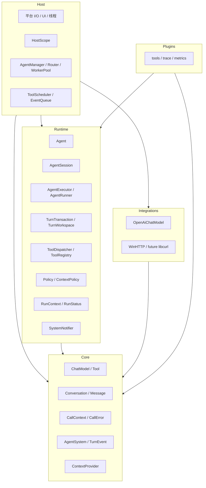
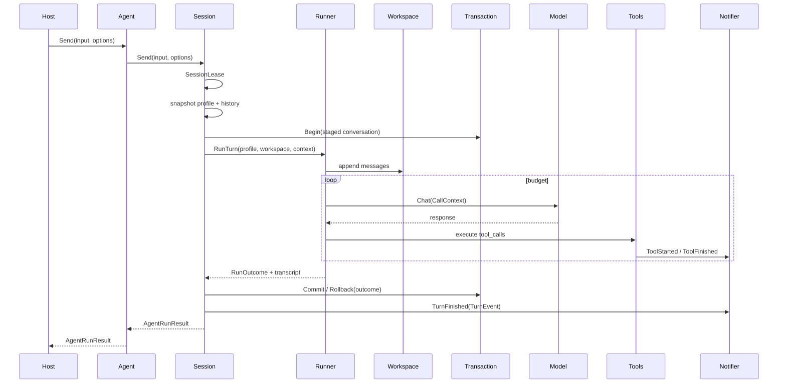

# 马里亚纳之心：框架设计

- 状态：目标框架 v2（经过代码审计、文档审计、Host 契约、组件模型和红队复核）
- 更新日期：2026-11-04
- 关联：[运行时架构](runtime-architecture.md)、[Agent 循环设计](agent-loop-design.md)、[项目总路线](../../Agent项目-实施路径.md)

## 1. 定位

马里亚纳之心是一个宿主无关的 Agent 运行时框架。

它负责：

- 管理 Agent 身份、配置、会话和运行生命周期；
- 执行一次有界、可取消、可观测的 Agent Turn；
- 通过 Tool / ContextProvider / Policy / Executor 组合能力；
- 给 CLI、UE、服务端、Worker 提供稳定边界。

它不负责：

- Router / Worker 编排；
- 宿主 UI、线程池、事件循环；
- SessionStore、长期记忆的具体存储；
- 动态插件 ABI；
- 模型训练、RAG、微调。

## 2. 十条原则

1. **core 只定义调用契约，不定义 Agent 运行状态。**
2. **runtime 负责 Agent、Session、Turn、工具执行和预算。**
3. **Host 负责组合、线程、I/O、UI、业务事实和生命周期管理。**
4. **必需依赖显式注入；ServiceRegistry 只做可选服务装配。**
5. **一个 Agent 是一个独立运行上下文，但不是进程/宿主。**
6. **同一 Session 串行、不同 Session 并行；并发冲突返回 Busy。**
7. **历史是事务，且只有一个 owner。**
8. **取消不撤销已发生的工具副作用；副作用必须可记录、可审计。**
9. **能力组合先编译期静态装配，再考虑动态插件。**
10. **Router / Worker / AgentManager 不进入 core。**

## 3. 分层



依赖方向：

```text
hosts → runtime → core
hosts → integrations → core
plugins → runtime / core
```

禁止：

- core 反向依赖 runtime / host / 网络 / 文件系统；
- runtime 持有 UObject / UMG / 平台句柄；
- Runner 反向查全局 Registry；
- runtime 直接依赖具体 integration（model/transport 通过 core 接口注入）；
- 插件修改执行结果以外的东西。

## 4. 对象模型

### 4.1 core

| 对象 | 职责 |
|---|---|
| `ChatModel` | 一次模型调用抽象 |
| `ChatRequest` / `ChatResponse` | 模型协议；只带 `CallContext` |
| `Tool` / `ToolSpec` / `ToolResult` | 工具调用协议；`ToolSpec` 只表示线上 schema |
| `Conversation` / `ChatMessage` | 可序列化消息状态 |
| `CallContext` | 单次调用的取消和 deadline |
| `CallError` | 调用级错误分类 |
| `AgentSystem` / `TurnEvent` | 只读观察者契约 |
| `ContextProvider` | 上下文源接口，不负责排序/预算 |

core 不出现：

- `session_id` / `run_id`；
- `RunBudget` / `RunStatus`；
- 工具调用次数/输出预算；
- 审批/会话/历史事务。

### 4.2 runtime

| 对象 | 职责 |
|---|---|
| `AgentDescriptor` | 身份、版本、能力、默认 profile |
| `AgentScope` | Agent 私有作用域（ServiceRegistry child） |
| `Agent` | 身份 + Session + AgentScope 门面 |
| `AgentSession` | 可变配置、历史、并发、记录、Turn 事务 owner |
| `AgentRunResult` | 对外 Turn 结果 |
| `RunContext` | session/run/budget/调用上下文 |
| `RunBudget` | 模型/工具/输出/时间预算 |
| `RunStatus` / `RunErrorCode` | Turn 结果状态 |
| `AgentExecutor` | Turn 执行策略接口 |
| `AgentRunner` | 默认 ReAct 实现 |
| `RunnerDependencies` | Executor 必需依赖 |
| `TurnWorkspace` | 本轮 staged 写入视图 |
| `TurnTransaction` | 提交/回滚/半批清理；由 Session 持有 |
| `ToolDispatcher` | 策略、预算、去重、执行记录 |
| `ToolScheduler` | 宿主线程/主线程工具接入点 |
| `ToolRegistry` / `ToolDescriptor` | 工具集合与治理元数据 |
| `SystemNotifier` | 观察者通知与异常隔离；快照遍历 |
| `ServiceRegistry` | Host/Agent 作用域装配工具 |

### 4.3 所有权

```text
Host
 └─ HostScope
     └─ AgentManager
         └─ Agent
             ├─ AgentDescriptor（不可变）
             ├─ AgentScope（ServiceRegistry child，随 Agent 存亡）
             │   ├─ ToolRegistry / ContextPipeline
             │   ├─ Policies / SystemRegistry / metrics / tracer
             │   └─ 组件实例
             └─ AgentSession
                 ├─ AgentProfile（唯一可变配置）
                 ├─ Conversation
                 ├─ AgentExecutor（shared_ptr）
                 ├─ TurnTransaction
                 └─ TurnRecord[]
```

规则：

- Session 持有 executor；Agent 不重复持有；
- Agent 持有 AgentScope；HostScope 生命周期长于所有 Agent；
- Runner 依赖由组合根构造，不反向查 scope；
- TurnTransaction 由 Session 持有；Runner 只操作 `TurnWorkspace`；
- Agent 公共 API：`Send`、`ClearHistory`、`Session`、`SessionId`、`History`、`Profile`、`SetProfile`、`Reconfigure`、`Id`、`Descriptor`、`Dependencies`。

## 5. 上下文与错误

### 5.1 CallContext

```cpp
struct CallContext
{
    std::stop_token stop_token;
    std::chrono::steady_clock::time_point deadline;
};
```

只给 Model / Tool / ToolScheduler 使用。

### 5.2 RunContext

```cpp
struct RunContext
{
    std::string session_id;
    std::string run_id;
    core::CallContext call;
    RunBudget budget;
};
```

### 5.3 预算单一来源

`MakeRunContext(profile, session_id, options)` 是唯一预算生成点。

- `AgentProfile` 同名字段只作为默认值；
- Runner 内不再做 `min(profile, context)`；
- 删除 Executor 的“便捷 RunTurn 重载”，避免二次生成 RunContext；
- 生效预算由 `RunContext` 承载；TurnRecord 预算持久化属于 F1。

### 5.4 错误与状态

core：

```text
CallError
  None / Cancelled / DeadlineExceeded
  ModelFailure / ToolFailure
```

runtime：

```text
RunStatus
  Completed / Cancelled / Failed / BudgetExceeded / Busy

RunErrorCode
  None / Cancelled / DeadlineExceeded
  InvalidInput / InvalidConfiguration / Busy
  ModelCallLimit / ToolCallLimit / ToolOutputLimit
  ModelFailure / IncompleteResponse / EmptyResponse
  ToolDenied / ToolFailure / InvalidToolCall / InternalError
```

规则：

- ChatModel/Tool 只返回 `CallError`；
- Runner 通过 `ToRunError` 把 `CallError` 映射为 `RunErrorCode`；
- `ToolResult` 不承载 run 级错误；调度层用 `ToolDispatchResult` 和 `ToolExecutionRecord::dispatch_error_code`；
- `RunStatus × RunErrorCode` 矩阵集中在一个文件，不散落 if/else。

## 6. 一次 Turn



### 6.1 事务唯一 owner

- `TurnTransaction` 归 `AgentSession`；
- `AgentExecutor::RunTurn` 只拿 `TurnWorkspace`，返回 `RunOutcome`；
- Runner 不调用 `Transaction.Start/Finish`；
- Session 独占 Start/Commit/Abort；
- `history_committed` 不再跨接口暴露；它是 Session 内部状态；
- 直调 `AgentRunner::RunTurn` 只得到 staged 结果，不自动改正式历史。

### 6.2 阶段 × 处置

| 阶段 | 失败/取消 | 对话历史 | 工具记录 |
|---|---|---|---|
| 预检 | 输入/配置/Busy | 不变 | 不新增 |
| 用户输入后、模型前 | 取消/deadline | 回滚到本轮前 | 无 |
| assistant 已写、工具批次未完整 | 模型失败/预算 | 保留用户输入与完整批次，移除半批 | 保留已登记 |
| 工具批次完整、后续模型失败 | 模型失败/预算 | 保留完整批次 | 保留 |
| 工具执行中 | 取消/deadline | 保留用户输入，批次标未完成 | 保留 `execution_started` 记录 |
| 提交窗口 | 取消 | **不可取消**，按已完成处理 | 保留 |

取消是协作式的：commit 开始后不可取消；阻塞中的同步工具/HTTP 只能等待其返回或在边界检查。

Session 级预检（空输入、非法 max_steps、已取消/deadline）在事务开始前返回，不写历史、不写 TurnRecord、不发 Turn 事件。工具注册表相关的 Executor 预检目前仍在事务内，F1 前移。

### 6.3 RunOutcome

```cpp
struct RunOutcome
{
    RunStatus status;
    RunErrorCode error_code;
    std::string error;
    std::string content;
    int steps;
    std::size_t tool_attempts;
    std::vector<ToolExecutionRecord> tool_executions;
};
```

本轮消息增量写在 `TurnWorkspace` 的 staged conversation 里，`RunOutcome` 不再重复携带 transcript。

Session 根据 `RunOutcome` 和事务阶段决定提交/回滚，不依赖隐形 flag。

## 7. Host 契约

### 7.1 Host 负责

- HostScope：transport、model 工厂、ComponentCatalog、权限源、共享时钟/日志；
- AgentScope：tools、policies、context pipeline、systems、metrics/tracer、executor；
- AgentManager：AgentId → Agent 生命周期；
- 线程池 / GameThread 编组 / UI 事件队列；
- ToolScheduler 实现：主线程工具、事务、确认；
- 世界事实、业务校验、记忆、持久化；
- Router / Worker / 任务队列；
- `SendAsync`、generation、取消注册表、迟到结果抑制。

### 7.2 runtime 负责

- 一次 Turn 的取消、deadline、预算；
- Session 单飞和 Busy；
- Turn 事务；
- ToolDispatcher；
- RunContext / RunStatus / TurnRecord；
- 不负责线程池、UI、事件循环、Agent 注册表。

### 7.3 UE 线程模型

```text
GameThread        UObject / UMG / Slate / 事务 / ToolScheduler 任务
AgentWorker       包装同步 Agent::Send；每 Session 串行
HTTP              异步完成，唤醒 Worker
UI EventQueue     Notifier 只投递，GT 消费
```

关键不变量：

- GameThread 不调用阻塞 `Send`；
- Worker 不碰 UObject；
- ToolScheduler 不得让 GameThread 等自己；
- Worker → GT 任务必须可取消、可超时、可 drain；
- Agent 销毁顺序：request_stop → drain GT 任务 → 等待 in-flight Send → close trace → erase；
- 迟到回调用 `{session_id, run_id, generation}` 丢弃；
- 取消不撤销副作用，但必须保留 `ToolExecutionRecord`；
- 审批未设计前禁止开放写工具。

### 7.4 SendAsync

runtime 保持同步 `Send`；Host 层提供：

```cpp
struct RunHandle
{
    std::string session_id;
    std::string run_id;
    std::uint64_t generation;
};

RunHandle AgentManager::SendAsync(AgentId agent_id, std::string input,
                                  std::function<void(AgentRunResult)> on_done);
void AgentManager::Cancel(RunHandle handle);
void AgentManager::DrainGameThreadTasks();
```

`on_done` 必须投递到 Host 拥有的线程/队列；runtime 不回调宿主 UI。

## 8. 组件组合

### 8.1 现在的优先级

当前**不实现** Catalog/Blueprint/Builder 三件套。

先做：

- 组合根拆分：HostServices / AgentFactory / RunLoop / ToolCatalog；
- `ValidateComposition()`：构建期校验依赖、权限、线程亲和；
- Tool 元数据 MVP。

三件套推迟到 F4（第二宿主/多 Agent 真实需要时）。

### 8.2 目标结构

```text
HostScope
 ├─ ComponentCatalog（冻结、只读）
 ├─ Host services
 └─ AgentManager
      └─ Agent
           ├─ AgentScope
           │   ├─ ToolRegistry
           │   ├─ ContextPipeline
           │   ├─ Policy
           │   ├─ Validator
           │   ├─ SystemRegistry
           │   └─ Executor
           └─ AgentSession
```

### 8.3 薄模型

- `ComponentCatalog`：只保留 id/kind/factory(+version 可选)；Host 级、Freeze 后只读；
- `AgentBlueprint` / `AgentBuilder`：先合并为 `AgentFactory`，接受配置数据并返回 Agent；
- Builder 只装配 + 校验，不执行、不编排；
- 组件依赖用**结构校验**，不通过字符串反向查 ServiceRegistry。

### 8.4 ToolDescriptor

`core::ToolSpec` 是发给模型的线上格式，不能塞治理字段。

新增 runtime：

```cpp
struct ToolDescriptor
{
    std::string name;
    std::string description;
    bool side_effects = false;
    AccessScope access_scope = AccessScope::Read;
    ApprovalMode approval = ApprovalMode::NotRequired;
    std::string thread_affinity = "worker";
};
```

MVP 只消费：

- `side_effects`
- `access_scope`
- `approval`

`idempotency`、`version`、`config_schema` 先声明/暂不消费；`timeout` 用 CallContext deadline 表达。

### 8.5 能力接线

- Tool：ToolRegistry + ToolPolicy + ToolDispatcher；
- Context：ContextPipeline，按顺序注入，失败 fail-closed；
- Executor：AgentExecutor，可选 ValidatingExecutor 装饰器；
- Validator：校验 RunOutcome / 输出契约；
- Policy：Host 权限 ∩ Agent 策略，deny wins；
- 所有组件在 Build 期校验，不在运行期才发现缺依赖。

### 8.6 分阶段

```text
F0  手写组合根 + ValidateComposition + ToolDescriptor + ErrorCode 分层 + CLI 拆分（已完成）
F1  ContextPipeline / Validator / ToolCatalog 深化 / eval
F2  UE Host（SendAsync / ToolScheduler / UI 队列）
F3  AgentManager + 多 Agent
F4  ComponentCatalog + AgentFactory/Blueprint + 动态插件评估
```

## 9. 工具治理

Tool 元数据（runtime `ToolDescriptor`）逐步补齐：

```text
name / description / parameters（core ToolSpec）
side_effects
access_scope（read / write / network / host）
approval（required / not_required / async）
thread_affinity
```

执行规则：

1. `name` 必须在 allowlist；
2. policy 在 scheduler 前；
3. Host 授权 ∩ Agent 策略，deny wins；
4. 同一 Turn 内 call id 去重；同 id 不同参数 → `InvalidToolCall`；
5. 输出预算与截断在 Dispatcher；
6. 异常 → `ToolFailure`，不穿越调度边界；
7. 副作用记录独立于历史回滚；
8. 重放也要产生事件，带 `replayed` 标记；
9. 跨轮幂等通过 runtime 生成 operation id（不采信模型 call id），当前仅设计和记录，不承诺 exactly-once。

## 10. 观察与追踪

`AgentSystem` 只读，不改变结果。

core 事件：

```cpp
struct TurnEvent
{
    std::string session_id;
    std::string run_id;
    std::string status;      // 字符串，core 不引 runtime 枚举
    std::string error_code;
    int steps = 0;
    std::size_t tool_attempts = 0;
    bool replayed = false;
};
```

规则：

- `AgentSystem::OnTurnEnded(const TurnEvent&)`；旧 `(bool,error,steps)` 保留为兼容桥；
- `SystemNotifier` 归 runtime，遍历前快照结果；
- 观察者异常隔离，不影响 RunStatus；
- `TurnFinished` 必须在 Session 完成 commit/rollback 后发布；
- FileTracer 与 AgentSession 使用同一个 session_id；
- 事件记录 session_id / run_id / status / error_code；
- 工具重放产生事件；
- UI 事件队列属于 Host；core/runtime 不实现事件总线。

## 11. 多 Agent / Router / Worker

```text
Host AgentManager
  ├─ Agent A（NPC）
  ├─ Agent B（NPC）
  └─ Worker Agent（短生命周期）
        ↑
      Router
```

- 1 NPC = 1 Agent；
- AgentManager 持对象弱引用 + Agent + stop_source + 串行输入队列 + generation；
- 忙则合并/排队，由 Host 决定优先级；
- Router 只依赖 Agent 公共 API 和 `session_id/run_id`；
- Worker 是短生命周期 Agent；
- Router/Worker 不进入 core；
- 共享 model/transport/tool 必须线程安全，或 per-agent 实例；
- Agent 销毁先 cancel，再 drain，再等待，再释放；
- Agent 间并行；Session 内部串行。

## 12. 路线图

### F0：框架收口（已完成）

1. Session 持有 TurnTransaction；Executor 返回 RunOutcome + transcript，删 `history_committed` 跨接口；
2. 预算单一来源：MakeRunContext，删 Executor 便捷重载和 Runner `min()`；
3. `TurnEvent` + SystemNotifier(runtime/快照) + FileTracer 关联 session/run/status/replay；
4. AgentScope/Agent 所有权收口；Session/Executor 使用同一 SystemRegistry；Agent 未传 systems 时从 executor 采纳并回写 scope；
5. ToolDescriptor MVP + ValidateComposition + ToolCatalog；
6. CallError / RunErrorCode / ToolDispatchResult 分层；
7. CLI 组合根拆分：HostServices / AgentFactory / RunCliLoop；
8. ExecuteTurn 统一事务/事件协议；Session 预检前移；Records 上限；
9. 补事务阶段矩阵、错误映射、notifier/trace replay、预检语义测试。

拆 PR 顺序：

```text
PR1  事务契约：RunOutcome + Session owner + 测试
PR2  预算单源 + 删便捷重载
PR3  TurnEvent + notifier + trace
PR4  AgentScope/Agent 所有权收口
PR5  ToolDescriptor + ValidateComposition
```

### F1：A3 能力

- ContextProvider + ContextPipeline；
- Summary / 长期记忆接口；
- eval/tasks + runner；
- 取消/超时/预算 DoD 补测；
- ToolCatalog 工具元数据深化；
- 观察/追踪契约稳定。

### F2：B1 UE Editor

- Host contract；
- FHttpTransport；
- ToolScheduler GameThread；
- 编辑器工具 + FScopedTransaction；
- SendAsync / generation；
- 共享 core，不做第二套 Runner。

### F3：B3 NPC / 多 Agent

- AgentManager；
- 每个 NPC 一个 Agent；
- 世界快照 / 业务校验；
- 场景销毁 / 迟到结果；
- 打包安全。

### F4：C

- ComponentCatalog / AgentFactory；
- Router / Worker；
- SessionStore / checkpoint；
- C ABI / 动态插件 / MCP。

## 13. 当前不做什么

- 不做全局 ServiceRegistry；
- 不做 Runner 内 service locator；
- 不做 core 内 Router/Worker/AgentManager；
- 不做事件总线进 core；
- 不做动态插件 ABI；
- 不做运行中热配置；
- 不做工具 exactly-once；
- 不把 UE 类型下沉到 runtime/core；
- 不在 F0 做 ComponentCatalog/Blueprint/Builder。

## 14. 状态与文档治理

- 当前状态只维护在 `agent-core/README.md`；
- 方向性规划在根目录三份文档；
- 技术契约在 `docs/framework.md` / `docs/runtime-architecture.md`；
- 阶段命名：
  - 实况：A0/A1/A2/A3/A4、B1/B2/B3、C；
  - 产品：M0–M5；
  - UE：P0–P6；
  - 框架：F0–F4；
- 映射表：

```text
F0 = A2.5（运行时收口，已完成）
F1 ≈ A3（ContextProvider / 记忆 / eval）
F2 = B1/B2（UE Editor）
F3 = B3（NPC / AgentManager）
F4 = C（Router/Worker / 持久化 / C ABI）

M0/M1 由 F0 + CLI 覆盖；M2 = F3；M3/M4/M5 属 F4/C。
UE P0–P4 = F2；P5 = F3；P6 = F4。
```

每次阶段变化同步更新映射表，不再各写一套状态。
