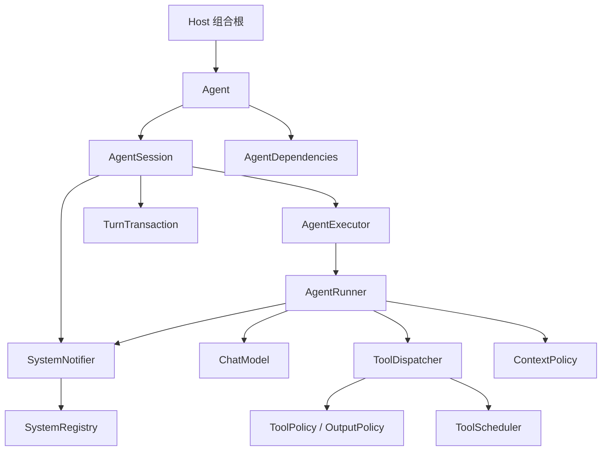
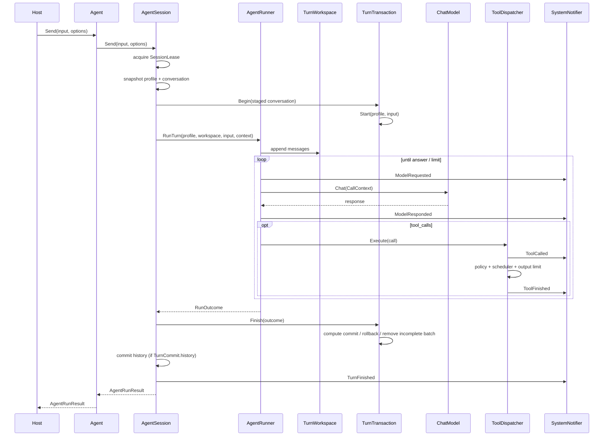

# 运行时架构

- 状态：A2 + F0 已完成，A3（F1）进行中
- 更新日期：2026-11-05
- 关联：[Agent 循环设计](agent-loop-design.md)、[项目总路线](../../Agent项目-实施路径.md)、[框架设计](framework.md)

## 1. 设计目标

马里亚纳之心的运行时只负责一件事：

> 把一个 Agent 配置、一段会话历史和一次用户输入，安全地执行成一轮可观测、可取消、可回滚的结果。

它不负责：

- Router / Worker 编排；
- 宿主 UI 和事件循环；
- 动态插件 ABI；
- 持久化 SessionStore；
- 模型训练、RAG、微调。

这些能力以后接在运行时边界之外，而不是塞进 `AgentRunner`。

## 2. 分层



依赖方向：

```text
hosts → runtime / plugins / integrations → core
```

- `core`：消息、模型、工具、运行上下文、观察者接口；
- `runtime`：Agent、Session、Executor、Runner、事务、工具执行；
- `plugins`：工具、trace、metrics；
- `integrations`：模型和 HTTP；
- `hosts`：组合根、I/O、命令。

## 3. 对象模型

| 对象 | 职责 | 不负责 |
|---|---|---|
| `AgentDescriptor` | 身份、名称、版本、能力、默认配置 | 可变运行状态 |
| `AgentScope` | Agent 私有服务作用域（ServiceRegistry child） | 跨 Agent 共享 |
| `AgentDependencies` | AgentScope + executor | 单次 Turn 状态 |
| `Agent` | 身份 + Session + AgentScope + 对外 `Send/ClearHistory/SessionId` | 具体 ReAct 循环 |
| `AgentSession` | 可变配置、历史、并发保护、执行记录、Turn 事务、Session systems | 模型/工具调用细节 |
| `RunContext`（runtime） | `run_id`、`session_id`、预算、调用级取消/deadline | 业务语义 |
| `CallContext`（core） | 单次模型/工具调用的取消与 deadline | session/run/预算 |
| `AgentExecutor` | 一次 Turn 的执行策略接口 | 历史提交/回滚 |
| `AgentRunner` | 默认 ReAct 实现：模型 ↔ 工具循环 | Host 组合、UI 线程 |
| `TurnWorkspace` | 本轮 staged 写入视图 | 历史提交/回滚 |
| `TurnTransaction` | 本轮历史的提交、回滚、半批清理；由 Session 持有 | 工具执行 |
| `RunOutcome` | Executor 的纯输出 | session/run/history |
| `ToolDispatcher` | 允许列表、策略、预算、去重、执行记录 | 模型调用 |
| `ToolScheduler` | 宿主主线程/线程模型接入点 | 工具业务逻辑 |
| `ToolRegistry` | 工具集合与治理元数据 | 模型调用 |
| `ToolDescriptor` | side_effects / access_scope / approval / thread_affinity | 线上 ToolSpec |
| `CompositionValidation` | 依赖、工具元数据、线程亲和、审批的构建期校验 | 执行 Turn |
| `SystemNotifier` | runtime 侧隔离并分发 `AgentSystem` 回调；遍历前快照 | 改变执行结果 |
| `SystemRegistry` | 观察者注册 | 业务策略 |
| `ServiceRegistry` | Host / Session 作用域服务装配 | Runner 依赖查找 |
| `TurnEvent` | 结构化 Turn 事件：session/run/status/error_code/steps/replayed | 控制执行流 |

### Agent 与 Session 的边界

```text
Agent = 谁 + AgentScope + 哪一段会话
Session = 当前配置 + 历史 + executor + 执行记录 + Turn 事务
```

- `AgentScope` 是 HostScope 的 child；Agent 持有非空 scope（缺省时创建空 scope）；
- `AgentDescriptor::default_profile` 不可变；
- 唯一可变配置由 `AgentSession` 持有；
- `Agent::Profile()`、`History()`、`Dependencies()` 返回快照；
- `Agent::SessionId()` 暴露会话关联，供 Host/Router 使用；
- 切换配置/工作区通过 `Reconfigure` 创建新 executor，不在运行中直接改历史。

### Runner 的依赖

```cpp
struct RunnerDependencies
{
    std::shared_ptr<core::ChatModel> model;
    std::shared_ptr<const ToolRegistry> tools;
    std::shared_ptr<const ToolPolicy> tool_policy;
    std::shared_ptr<const ContextPolicy> context_policy;
    std::shared_ptr<const ToolOutputPolicy> tool_output_policy;
    std::shared_ptr<ToolScheduler> tool_scheduler;
    std::shared_ptr<core::SystemRegistry> systems;
};
```

Runner 不从 `ServiceRegistry` 查依赖；组合根显式装配，缺失时构造失败。

## 4. 一次 Turn 的生命周期



> `TurnFinished` 在 commit/rollback 之后发布，当前已实现。

## 5. RunContext 与 CallContext

`core` 只认识单次调用需要的上下文：

```cpp
struct CallContext
{
    std::stop_token stop_token;
    std::chrono::steady_clock::time_point deadline;
};
```

`runtime` 的 RunContext 持有身份、预算，并把调用级信息投影给 core：

```cpp
struct RunContext
{
    std::string session_id;
    std::string run_id;
    core::CallContext call;
    RunBudget budget;
};
```

`ChatRequest::call` 和 `Tool::Execute(..., const CallContext&)` 只接收 `CallContext`；session/run/budget 不进入 core。

| 字段 | 默认值 | 语义 |
|---|---|---|
| `max_steps` | 8 | 模型调用次数上限 |
| `turn_timeout_ms` | 120000 | 整轮总耗时预算 |
| `max_tool_calls` | 64 | 工具尝试次数 |
| `max_tool_output_bytes` | 32768 | 工具正文累计输出 |
| `timeout_ms` | 30000 | 单次 HTTP 请求总时限 |

规则：

- 一次 Turn 内多次模型请求共享同一个 deadline；
- HTTP 超时取 `min(config.timeout_ms, 本轮剩余时间)`；
- `Send(input, RunOptions)` 可以传入取消信号和本次超时；
- 取消不会自动撤销已经发生的工具副作用；
- 工具和自定义 scheduler 必须协作检查 `CallContext` / `RunContext`，框架不强制中断不配合的同步代码。

## 6. 结果与错误

```cpp
enum class RunStatus
{
    Completed,
    Cancelled,
    Failed,
    BudgetExceeded,
    Busy,
};
```

错误码分两层：

```text
core::CallError
  None / Cancelled / DeadlineExceeded / ModelFailure / ToolFailure

runtime::RunErrorCode
  None / Cancelled / DeadlineExceeded
  InvalidInput / InvalidConfiguration / Busy
  ModelCallLimit / ToolCallLimit / ToolOutputLimit
  ModelFailure / IncompleteResponse / EmptyResponse
  ToolDenied / ToolFailure / InvalidToolCall / InternalError
```

`ChatResponse` / `ToolResult` 只携带 `CallError`；Run 级错误由 `RunOutcome`、`TurnRecord` 和 `ToolExecutionRecord::dispatch_error_code` 携带。`ToRunError` 是唯一映射点。

`AgentRunResult` 携带：

- `status` / `error_code` / `error`
- `content`
- `session_id` / `run_id`
- `steps` / `tool_attempts`
- `tool_executions`

历史是否提交由 Session 内部处理，不再作为跨接口字段暴露。

调用方检查结构化字段，不要匹配错误文本。

## 7. 历史提交规则

| 结束原因 | 对话历史 | 工具记录 |
|---|---|---|
| 成功 | 提交完整本轮 | 保留 |
| 取消 / deadline / 内部异常 | 回滚到本轮开始 | 保留已登记操作 |
| 模型失败 / 响应不完整 / 预算耗尽 | 保留用户输入和完整工具批次，移除未完成批次 | 保留 |
| 输入/配置预检失败 | 不开始本轮 | 无 |
| 同 Session Busy | 不开始本轮 | 无 |

`AgentSession` 持有唯一的 `TurnTransaction`；`AgentExecutor` 只写 `TurnWorkspace` 并返回 `RunOutcome`。Runner 不决定提交/回滚。Session 与测试共用 `ExecuteTurn` 维护事务/事件顺序；Session 每轮复制一份 conversation 用于事务隔离，Records 默认最多保留 128 条。

### 7.1 Turn 事件

`core::TurnEvent` 是跨层观察契约：

```cpp
struct TurnEvent
{
    std::string session_id;
    std::string run_id;
    std::string status;
    std::string error_code;
    std::string error;
    int steps = 0;
    std::size_t tool_attempts = 0;
    bool ok = false;
    bool replayed = false;
};
```

- `OnTurnStarted(const TurnEvent&)` 在 executor 开始前发出；
- `OnTurnEnded(const TurnEvent&)` 在 Session commit/rollback 之后发出；
- 旧 `OnTurnStart()` / `OnTurnEnd(bool, error, steps)` 保留为兼容桥，默认转发；
- `SystemNotifier` 在 runtime 层，遍历观察者前做快照；
- trace 事件包含 `session_id`、`run_id`、`status`、`error_code`、`replayed`。

## 8. 工具执行

`ToolDispatcher` 在一次 Turn 内负责：

1. 工具尝试次数预算；
2. 取消/deadline 检查；
3. tool call id/name 校验；
4. 同一 Turn 内相同 id + 相同参数的缓存重放；
5. 允许列表与 `ToolPolicy`；
6. `ToolScheduler` 调度；
7. 输出预算与截断；
8. `ToolExecutionRecord`；
9. 重放事件（`replayed = true`）。

`ToolRegistry` 同时保存 `ToolDescriptor`：

```cpp
struct ToolDescriptor
{
    std::string name;
    std::string description;
    bool side_effects = false;
    ToolAccessScope access_scope = ToolAccessScope::Read;
    ToolApprovalMode approval = ToolApprovalMode::NotRequired;
    std::string thread_affinity = "worker";
};
```

`Runner` 在每次 Turn 前调用 `ValidateComposition`，检查：

- model / tools / policies / scheduler / systems 是否齐全；
- profile 中的 tool 是否存在且唯一；
- `thread_affinity` 是否受支持；
- 有副作用的工具是否要求审批。

`ToolExecutionRecord::execution_started` 表示已经提交给 scheduler，可能产生副作用；它不保证操作完成。工具重放只保证本轮内去重，不承诺跨轮/跨进程 exactly-once。

## 9. 并发与线程

- 同一 Session 同时只接受一个 `Send`；
- 同线程重入也返回 `Busy`，避免死锁；
- `ClearHistory`、`SetProfile`、`Reconfigure` 在运行中返回 false；
- 不同 Session 可以并行；
- 每个 Session 使用独立 Runner、`SystemRegistry`、metrics、tracer；AgentScope 与 Executor 必须使用同一个 `SystemRegistry` 实例，Agent 构造时会校验；
- 共享的 model/transport/tool 实例必须线程安全，或由 host 按 Session 创建独立实例；
- `SystemNotifier` 在同一执行线程同步通知，遍历前快照观察者，异常被隔离；
- `TurnStarted` 由 Session 在本轮开始前发出；`TurnFinished` 在 Session commit/rollback 之后发出；
- FileTracer 与 AgentSession 使用同一个 `session_id`，事件携带 `session_id`、`run_id`、`status`、`error_code`、`replayed`；
- `Send` 仍是同步 API；后台线程池和 UI 事件队列属于后续宿主层设计。

## 10. Host 集成

### CLI

```text
RunHost
  ├─ 解析参数 / 加载配置 / 解析 API key
  ├─ 创建 transport / workspace / ToolCatalog
  ├─ BuildHostServices：model + metrics + tracer + systems + scope + CliContext
  ├─ AgentFactory：CreateExecutor + CreateAgent
  └─ RunCliLoop → Agent::Send
```

CLI 当前只创建一个 Agent；多 Agent 不进入 CLI 组合根。

### UE / NPC

```text
Game Event
  → Host AgentManager
  → Agent
  → AgentRunner
      ├─ ToolScheduler → Game Thread tool
      └─ SystemNotifier → trace/metrics
```

`ToolScheduler` 是留给 UE 主线程工具的接入点；本阶段不实现 UE 插件。

### Router / Worker

Router/Worker 不进入 core：

- Router 负责选择 Agent、拆分任务、聚合结果；
- Worker 是短生命周期 Agent；
- Session 隔离、RunContext 的 `run_id/session_id`、取消、执行记录已经预留。

结构化事件队列和跨 Worker 事件订阅留到后续阶段。

## 11. 源码索引

```text
source/core/include/agent/core/
  call_context.h        CallContext / CallError
  agent_system.h        AgentSystem / TurnEvent
  system_registry.h     观察者注册
  tool.h                Tool / ToolResult
  chat_model.h          ChatRequest / ChatResponse

source/runtime/include/agent/runtime/
  agent_profile.h       AgentProfile / RunOptions
  execution_id.h        ExecutionId（NewSession / NewRun）
  run_context.h         RunContext / RunBudget / RunStatus / Create
  agent.h               AgentDescriptor / AgentScope / AgentDependencies / Agent
  agent_session.h       AgentSession
  agent_executor.h      AgentExecutor
  agent_runner.h        AgentRunner / RunnerDependencies
  agent_run.h           TurnRecord / ToEvent / AgentRunResult
  turn_transaction.h    TurnTransaction / TurnWorkspace / TurnCommit
  turn_executor.h       ExecuteTurn（Session 与测试共用）
  system_notifier.h     AgentSystem 通知隔离
  tool_descriptor.h     ToolDescriptor / access / approval
  composition.h         ValidateComposition
  tool_dispatcher.h     ToolDispatcher / ToolScheduler
  tool_registry.h       ToolRegistry
  tool_policy.h         ToolPolicy
  context_policy.h      ContextPolicy
  tool_output_policy.h  ToolOutputPolicy
  service_registry.h    scoped ServiceRegistry
```

## 12. 非目标

- 不在 core 中实现 Router/Worker；
- 不在 Runner 中做 service locator；
- 不在本阶段实现事件总线；
- 不实现动态插件 ABI；
- 不实现 Session 持久化；
- 不承诺工具 exactly-once。
